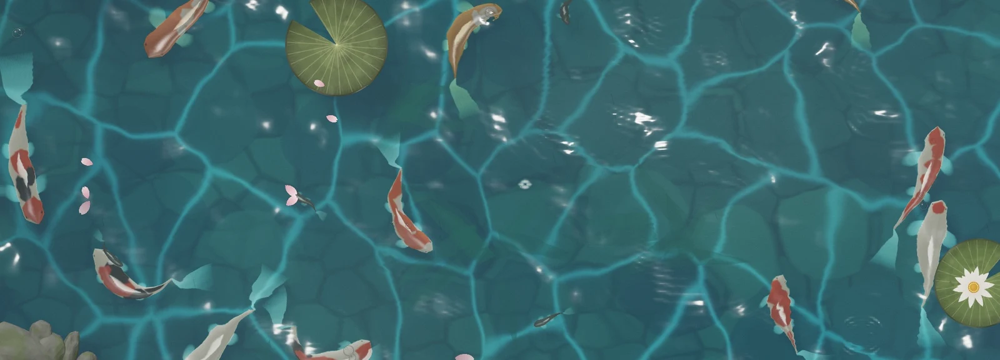
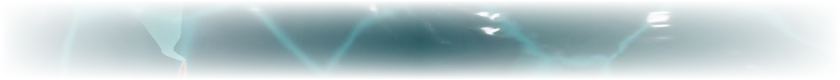
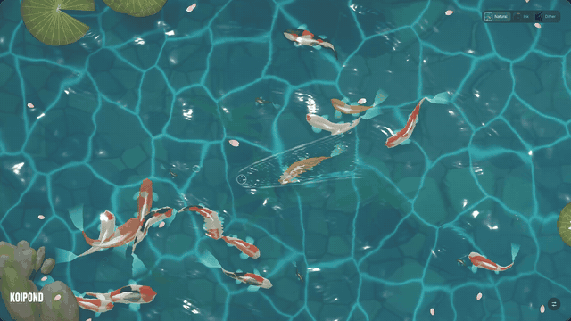
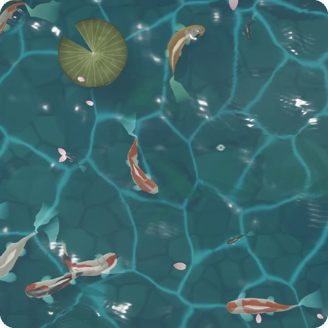
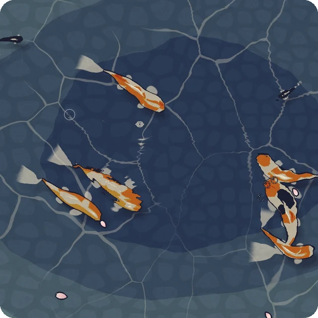
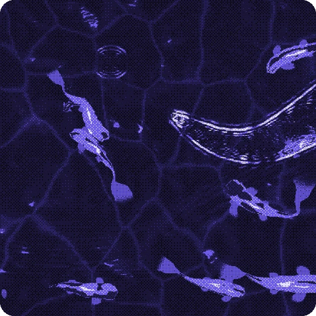

<a href="https://koipond-demo.vercel.app">
  
</a>

<h3 align="center">A living koi pond for the web.</h3>

<p align="center">
  Koi that swim on their own through real-looking water. Glide over it, tap it, feed them.<br>
  One React component, open source. <a href="https://koipond-demo.vercel.app">Try it live</a>.
</p>

<p align="center">
  <a href="https://github.com/Himanshu-Sangshetti/koipond/actions/workflows/ci.yml"></a>
  <a href="LICENSE"></a>
  <a href="https://www.npmjs.com/package/@hxlfed/koipond"></a>
  <a href="#install"></a>
  <a href="https://koipond-demo.vercel.app"></a>
  <a href="https://github.com/Himanshu-Sangshetti/koipond/stargazers"></a>
</p>

<p align="center">
  <a href="https://koipond-demo.vercel.app"><b>Live demo</b></a> ·
  <a href="#install"><b>Install</b></a> ·
  <a href="#the-looks"><b>Looks</b></a> ·
  <a href="#as-your-wallpaper-macos"><b>Wallpaper</b></a> ·
  <a href="#props"><b>Props</b></a> ·
  <a href="#how-it-works"><b>How it works</b></a> ·
  <a href="CONTRIBUTING.md"><b>Contributing</b></a>
</p>

<p align="center"></p>

## Install

**npm**

```bash
npm install @hxlfed/koipond three
```

```tsx
import { KoiPond } from "@hxlfed/koipond";

export default function Hero() {
  return <KoiPond style={{ height: "100vh" }} />;
}
```

**shadcn** copies the source into your project instead, so it's yours to change:

```bash
npx shadcn@latest add https://raw.githubusercontent.com/Himanshu-Sangshetti/koipond/main/public/r/koi-pond.json
```

```tsx
import { KoiPond } from "@/components/koi-pond";
```

Or copy [`src/`](src) into your project and install `three`.

It fills its parent, so give it a height. Works with React 18 and 19, Next.js (App Router included), Vite and
anything else that renders React. `three` (0.160 or newer) is the only other dependency.

<p align="center"></p>

## Play with it

<p align="center">
  <a href="https://koipond-demo.vercel.app"></a>
</p>

| Do this | And the pond… |
|---|---|
| Glide over the water | leaves a wake that catches the light |
| Hold still near the koi | the bold ones swim over to look |
| Move fast near a fish | the shy ones dart away |
| Tap | droplets jump and rings spread out |
| Double-tap or long-press | drops food; nearby koi race over to eat |
| Scroll or swipe | stirs a current; koi, petals and pads stream with it |

## As your wallpaper (macOS)

The pond can also live on your desktop, under your icons, and it still reacts to your mouse. Free, no account,
no other apps needed:

```sh
curl -fsSL https://raw.githubusercontent.com/Himanshu-Sangshetti/koipond/main/wallpaper/install.sh | sh
```

Click the fish in the menu bar for the looks, a focus timer and settings. More in [wallpaper/](wallpaper/).

<p align="center"></p>

## The looks

The same pond in three styles. Switch any time; the koi keep swimming and the new look ripples across the water.

<table>
  <tr>
    <td width="33%" align="center"><br><b>natural</b></td>
    <td width="33%" align="center"><br><b>ink</b></td>
    <td width="33%" align="center"><br><b>violet</b> (dither)</td>
  </tr>
</table>

`ember` and `mono` are two more dithered palettes, or pass your own `Look`.

<p align="center"></p>

## Props

| Prop | Default | |
|---|---|---|
| `look` | `"natural"` | `"natural"`, `"ink"`, `"violet"`, `"ember"`, `"mono"`, or your own `Look` object |
| `fish` | `12` | number of koi |
| `fishSize` | `0.18` | koi length relative to the pond's short side |
| `pads` | `4` | floating lily pads (some flower) |
| `petals` | `10` | sakura petals drifting onto the water |
| `minnows` | `4` | small dark fish |
| `rain` | `0.4` | `0` to `1` |
| `water` | | override `{ shallow, deep, caustics, waves, clarity }` on any look |
| `border` | `true` | a small cluster of rocks in one corner |
| `cursor` | `true` | over the pond the pointer becomes a soft ring (not on touch screens) |
| `scrollCurrent` | `true` | scroll / swipe stirs the water |
| `interactive` | `true` | pointer, taps, feeding and scroll |
| `seed` | `7` | same seed, same pond |
| `scale` | `1` | simulation resolution relative to the element |
| `className`, `style` | | passed to the wrapper element |

### Imperative handle

```tsx
import { useRef } from "react";
import { KoiPond, type KoiPondHandle } from "@hxlfed/koipond";

const pond = useRef<KoiPondHandle>(null);
// coordinates are 0..1 across the pond
pond.current?.feed(0.5, 0.5);
pond.current?.ripple(0.2, 0.7);
pond.current?.current(0.4, 0);          // push the water
pond.current?.formation(slots, flow);   // ask the koi to hold a shape (one slot per fish); null releases

<KoiPond ref={pond} />;
```

### A look of your own

```ts
import type { Look } from "@hxlfed/koipond";

const dusk: Look = { mode: "color", palette: ["#000", "#000", "#000", "#000"], deep: "#0b2a3c", shallow: "#1e5a64", pixel: 1, caustics: 1.2 };
const mono: Look = { mode: "dither", palette: ["#0a0a0a", "#333333", "#999999", "#f5f5f5"], deep: "#050505", shallow: "#1b1b1b", pixel: 2 };
```

<p align="center"></p>

## How it works

**Koi.** Each koi has a temperament (bold to shy, lazy to restless) that shapes every choice. It picks an
activity (drift, cruise, dart, rest, investigate, feed, flee) by weighted chance from its mood and what is
around it. The activity sets a goal heading and speed; neighbours, the pond edge, rocks and the water current
bend that goal; the fish turns toward it with limited, speed-dependent agility, like a heavy body.

**Bodies.** A chain of joints pulled by the head, with a cap on how sharply each joint may bend, so a koi flows
through a turn but never kinks. A muscle wave runs nose to tail, stronger toward the tail and with effort.
The tail fin is its own spring-driven chain, so it trails and flicks. Each koi is a lit 3D mesh with its own
painted markings, scales and translucent fins.

**Water.** One three.js renderer does everything. A wave equation runs on the GPU in two half-float render
targets, so every tap, raindrop, gulp and wake spreads, reflects and fades. The surface slope refracts a
pond floor that is baked once, light gathers on the floor and on every ripple, and colour deepens with depth.
Lily pads and rocks are lit 3D meshes on top; petals, flowers and splashes are drawn in 2D above them.

**Calm by default.** Fixed 60 Hz simulation steps; the pond pauses when it is off screen and shows a still
frame to people who prefer reduced motion.

## Browser support

Any browser with WebGL2 (all current desktop and mobile browsers). Without WebGL2 the component falls back
to a simpler stylised water.

## Credits

Inspired by the wider world of procedural koi ponds, including [nagomi](https://github.com/msk1039/nagomi).
No code is shared; koipond is written from scratch. Built on [three.js](https://threejs.org).

## License

[MIT](LICENSE)
