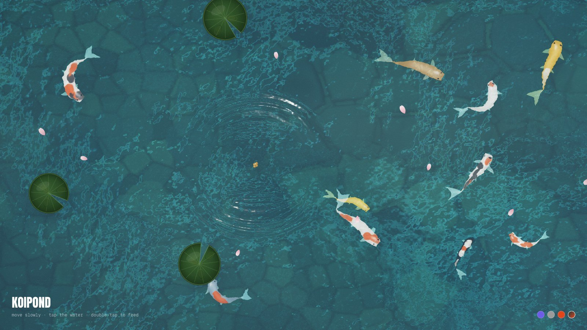

# koipond

A living koi pond for the web. Procedural koi swim through real-looking water: the surface refracts the
pond floor, caustics drift across the stones, ripples spread and interfere, and light fades into a
green-blue depth. Move slowly and curious koi come to look; tap the water; double-tap to feed them.



```bash
npm install koipond
```

```tsx
import { KoiPond } from "koipond";

export default function Hero() {
  return (
    <div style={{ height: "100vh" }}>
      <KoiPond fish={10} look="natural" />
    </div>
  );
}
```

## What you can do with the pond

| Do this | And the pond… |
|---|---|
| Move the pointer slowly, then stop | bold koi swim over to look, and sometimes nibble at the surface |
| Move fast near a fish | shy koi dart away |
| Tap the water | rings spread, bend everything under them, push petals and lily pads aside |
| Double-tap (or long-press) | drops food; nearby koi race to it and gulp it down |
| Nothing at all | koi drift, cruise, rest, rise and sink; the odd drop lands on the surface |

## Props

| Prop | Default | |
|---|---|---|
| `fish` | `9` | number of koi |
| `look` | `"violet"` | `"natural"`, `"violet"`, `"ink"`, `"ember"`, or your own `Look` |
| `fishSize` | `0.14` | fish length relative to the pond's short side |
| `pads` | `3` | floating lily pads |
| `seed` | `7` | same seed, same pond |
| `interactive` | `true` | pointer, taps and feeding |
| `scale` | `1` | simulation resolution relative to the element |

`look` can change at any time; the fish carry on swimming.

### A look of your own

```ts
const dusk = { mode: "color", palette: ["#000", "#000", "#000", "#000"], deep: "#071a2c", shallow: "#1e4660", tint: "#ffffff", pixel: 1 };
// or a 4-colour ordered dither:
const mono = { mode: "dither", palette: ["#0a0a0a", "#333", "#999", "#f5f5f5"], deep: "#050505", shallow: "#1b1b1b", pixel: 2 };
```

### Imperative handle

```tsx
const pond = useRef<KoiPondHandle>(null);
pond.current?.feed(0.5, 0.5);          // 0..1 coordinates
pond.current?.ripple(0.2, 0.7);
pond.current?.current(0.3, 0);         // push the water; fish and pads drift with it
pond.current?.formation(slots, flow);  // ask the koi to hold a shape (one slot per fish), null releases
```

## How it works

**The fish.** Every koi has a temperament (bold to shy, lazy to restless) that colours each choice. It picks
an activity (drift, cruise, dart, rest, investigate, feed, flee) by weighted chance from its mood and its
surroundings. The activity sets a goal heading and speed; neighbours, walls, keep-clear areas and the water
current bend that goal; the fish turns toward it with limited, speed-dependent agility, like a heavy body.

**The body.** A chain of joints pulled by the head, with a cap on how sharply each joint can bend, so the
body flows through turns but can never kink. A muscle wave runs from nose to tail, small at the head and
strong at the tail, scaled by how hard the fish is working. The tail fin is its own short chain on springs,
so it trails and flicks after the body.

**The water** (WebGL2). A height field on the GPU runs a damped wave equation, so every disturbance spreads,
reflects and interferes. The surface normal (waves plus fine wind ripples) refracts the procedural pond
floor and the fish layer. Light is absorbed with depth, red first, which gives the green-blue water, and is
scattered back from the water body. Caustics play on the floor and lightly on the fish. The surface
reflects a soft sky by Fresnel and catches sun glints. Lighting runs in linear light with a filmic tone
curve. Lily pads, petals and food float above it all, unrefracted.

**Calm by default.** The simulation runs in fixed 60 Hz steps, pauses when the pond is off screen, and
shows a still pond to people who prefer reduced motion. Without WebGL2 it falls back to a simpler water.

## Credits

Inspired by the wider world of procedural koi ponds, including
[nagomi](https://github.com/msk1039/nagomi). No code is shared; koipond is written from scratch.

MIT licensed.
